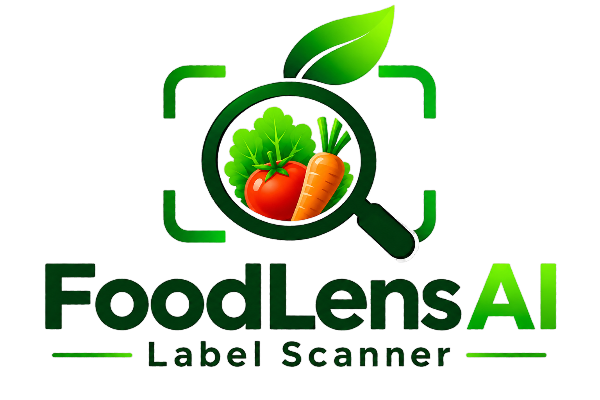
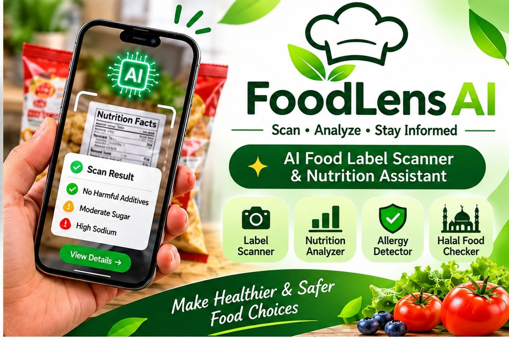

# FoodLens AI

<div align="center">



# FoodLens AI

### Scan. Analyze. Stay Informed.

**Understand what's inside your food before you buy it.**

Scan food ingredient labels, check dietary compatibility, identify potential allergens, and understand every ingredient with AI-assisted explanations.

[](https://foodlens-ai-lemon.vercel.app)
[]([YOUTUBE_URL])

<br>


<br>

[Features](#-features) · [How It Works](#-how-it-works) · [Tech Stack](#-technology-stack) · [Installation](#-getting-started) · [API](#-api-reference) · [Testing](#-testing) · [Team](#-team)

</div>

---

## Overview

Reading food labels shouldn't be complicated.

People following religious, ethical, or dietary restrictions often have to examine ingredient lists carefully. Small print, unfamiliar languages, and ambiguous ingredient names make this process even harder.

Ingredients such as gelatin, glycerin, E471, and mono- and diglycerides may have different sources that aren't identified on the packaging.

**FoodLens AI helps simplify this process.**

It combines AI-powered label recognition with a transparent ingredient rule engine to help users understand what's in their food.

Instead of simply returning a Yes or No, FoodLens explains individual ingredient results and highlights potential concerns.

## ✨ Features

| Feature | Description |
|---|---|
| 📷 **Smart Label Scanning** | Capture or upload food ingredient labels in different languages using AI vision. |
| ✍️ **Manual Ingredient Input** | Paste an ingredient list directly when scanning isn't convenient. |
| 🥗 **Five Dietary Profiles** | Check compatibility with Halal, Vegetarian, Vegan, Hindu-friendly, and Kosher profiles. |
| 🥜 **Allergen Detection** | Identify 14 allergen groups and highlight allergens selected by the user. |
| 🔍 **Ingredient Analysis** | Get individual OK, Doubtful, Not OK, or Unknown verdicts with explanations. |
| ⚠️ **Precautionary Alerts** | Handle separate statements such as "May contain" and shared-equipment warnings. |
| 📊 **Nutrition Information** | Display calories, protein, carbohydrates, fats, and other available nutrition information with its original serving basis. |
| 🤖 **AI-Assisted Verification** | Use Gemini and Google Search grounding to estimate unresolved ingredient sources, with confidence levels and source links. |
| 🔒 **Privacy-Focused Experience** | No account required. Recent checks remain on the user's device. |

### Understanding Ingredient Verdicts

FoodLens uses four verdict categories:

| Verdict | Meaning |
|---|---|
| ✅ **OK** | No conflict identified with the selected dietary profile. |
| 🟡 **Doubtful** | Compatibility depends on the ingredient's source or processing. |
| ⛔ **Not OK** | A conflict with the selected dietary profile was identified. |
| ❔ **Unknown** | No applicable rule is available. This is never treated as OK. |

The overall result follows the strictest ingredient verdict.

---
## System Architecture

FoodLens AI follows a hybrid architecture combining deterministic ingredient rules with AI-assisted recognition and estimation.

```text
                 USER
                  |
          +-------+-------+
          |               |
       Camera          Manual Input
          |               |
          v               |
     Gemini Vision         |
          |               |
          +-------+-------+
                  |
                  v
        Structured Ingredient Data
                  |
                  v
          Flask Backend
                  |
                  v
          Ingredient Engine
                  |
           +------+------+
           |             |
        Known        Unresolved
       Ingredients   Ingredients
           |             |
       Rule Engine   Gemini + Search
           |             |
           +------+------+
                  |
                  v
          Result Processing
                  |
        +---------+---------+
        |         |         |
      Verdict  Allergens  Nutrition
        |         |         |
        +---------+---------+
                  |
                  v
             FRONTEND
```

### Processing Pipeline

**1. Input Processing**

The application accepts a food label image or manually entered ingredient text.

**2. AI-Based Recognition**

For image uploads, Gemini Vision extracts structured information, including ingredients, precautionary statements, and available nutrition details.

**3. Deterministic Ingredient Analysis**

The backend evaluates recognized ingredients against `backend/data/ingredients.json`, containing 525 ingredient rules, E-number aliases, and allergen keywords.

Known conflicts are handled by the rule engine and cannot be overridden by AI estimates.

**4. AI-Assisted Estimation**

Gemini with Google Search grounding assists with unresolved ingredients. Estimates include confidence information and supporting source links.

Low-confidence or unsuccessful estimates preserve the original classification and provide a warning.

**5. Result Generation**

The application returns ingredient classifications, overall dietary compatibility, allergen alerts, precautionary warnings, and available nutritional information.

### AI Integration and Validation

AI is used as an analysis assistant, not as the sole decision-making authority.

| Component | Responsibility |
|---|---|
| Gemini Vision | Extract structured information from food label images. |
| Ingredient Rule Engine | Classify known ingredients using predefined rules. |
| Gemini + Google Search | Assist with unresolved ingredient sources. |
| Backend Validation | Validate AI responses and enforce application rules. |
| Frontend | Present analysis results and explanations. |

Additional safeguards include:

- Treating package text as untrusted data rather than instructions.
- Rejecting unreadable, cropped, and non-label images.
- Preserving known rule-based conflicts.
- Keeping AI estimates distinguishable from established classifications.
- Returning structured errors instead of exposing internal exceptions or API credentials.

For further details, see [AI Usage Documentation](docs/AI_USAGE.md).

## Technology Stack

| Layer | Technologies |
|---|---|
| Frontend | HTML5, CSS3, Vanilla JavaScript |
| Backend | Python, Flask |
| AI Integration | Google Gemini, Google Search grounding |
| Data Validation | Pydantic |
| AI SDK | `google-genai` |
| Testing | Pytest |
| Deployment | Vercel |

The frontend uses native HTML, CSS, and JavaScript without requiring a frontend build process.

## Getting Started

### Prerequisites

- Python 3.10 or newer
- Git
- Google Gemini API key

Generate an API key through [Google AI Studio](https://aistudio.google.com/apikey).

### 1. Clone the Repository

```bash
git clone https://github.com/AbubakerAfzal01/foodlens-ai.git

cd foodlens-ai
```

### 2. Create a Virtual Environment

**Windows (PowerShell)**

```powershell
py -m venv .venv
.venv\Scripts\Activate.ps1
```

**macOS / Linux**

```bash
python3 -m venv .venv
source .venv/bin/activate
```

### 3. Install Dependencies

```bash
python -m pip install -r requirements.txt
```

### 4. Configure Environment Variables

Create a local environment file.

**Windows**

```powershell
Copy-Item .env.example .env
```

**macOS / Linux**

```bash
cp .env.example .env
```

Configure your API key in `.env`:

```env
GEMINI_API_KEY=your_key_here
VISION_PROVIDER=gemini
```

### 5. Start the Application

```bash
python run.py
```

Open the application:

```text
http://localhost:5000
```

### Offline Demonstration Mode

For testing without a Gemini API key, configure:

```env
VISION_PROVIDER=mock
```

Mock mode returns a predefined sample result for uploaded images and does not perform actual image recognition. Manually entered ingredients continue to use the real rule engine.

> **Security:** Never commit `.env` or expose your API key. Only `.env.example` with an empty key should be included in the repository.

### Environment Variables

| Variable | Default | Description |
|---|---|---|
| `VISION_PROVIDER` | `gemini` | Selects Gemini or mock mode. |
| `GEMINI_API_KEY` | Empty | Google AI Studio API key. |
| `GEMINI_MODEL` | `gemini-3.6-flash` | Model used for scanning and estimates. |
| `AI_TIMEOUT_SECONDS` | `45` | Maximum timeout for an individual AI request. |
| `MAX_IMAGE_BYTES` | `4194304` | Maximum image size (4 MB). |
| `RATE_LIMIT_PER_MIN` | `10` | Requests allowed per minute per IP. |
| `TRUST_PROXY` | `0` | Enables trusted reverse-proxy handling. |

## Deployment

FoodLens AI includes configuration for deployment on Vercel.

### Deployment Requirements

The repository includes:

- `api/index.py` — Vercel serverless entry point.
- `vercel.json` — deployment configuration.
- `frontend/` — frontend application.
- `backend/` — Flask application and services.

### Deployment Steps

1. Import the GitHub repository into [Vercel](https://vercel.com/).
2. Set the Root Directory to `./`.
3. Select **Other** as the Framework Preset.
4. Configure the following environment variables:

```env
GEMINI_API_KEY=your_key_here
VISION_PROVIDER=gemini
TRUST_PROXY=1
```

5. Deploy the application.
6. Verify the backend endpoints:

```text
/api/health
/api/mode
```

The mode endpoint should report:

```json
{
  "photo_scan_available": true
}
```

**Deployment consideration:** Serverless instances maintain separate in-memory rate-limit counters. Configure an appropriate spending cap for the Gemini API key.

## Project Structure

```text
foodlens-ai/
│
├── api/
│   └── index.py
│
├── backend/
│   ├── __init__.py
│   ├── config.py
│   ├── routes.py
│   ├── ratelimit.py
│   │
│   ├── services/
│   │   ├── vision.py
│   │   └── engine.py
│   │
│   └── data/
│       ├── ingredients.json
│       └── products.json
│
├── frontend/
│   ├── index.html
│   ├── css/
│   │   └── styles.css
│   ├── js/
│   │   └── app.js
│   └── assets/
│
├── tests/
│
├── scripts/
│   └── eval_labels.py
│
├── docs/
│   ├── AI_USAGE.md
│   ├── ARCHITECTURE.md
│   ├── DIET_RULES.md
│   └── TEST_TABLE.md
│
├── requirements.txt
├── run.py
├── vercel.json
└── .env.example
```

## API Reference

### Available Endpoints

| Method | Endpoint | Description |
|---|---|---|
| GET | `/api/health` | Application health check. |
| GET | `/api/mode` | Returns application mode and photo-scanning availability. |
| GET | `/api/diets` | Returns supported dietary profiles. |
| POST | `/api/analyze` | Analyzes uploaded images or manually entered ingredients. |

### Analyze Request

`POST /api/analyze`

The endpoint accepts multipart form data or JSON.

| Parameter | Description |
|---|---|
| `image` | Uploaded food label image. |
| `ingredients` | Manually entered ingredient list. |
| `diet` | Selected dietary profile. |
| `allergies[]` | User-selected allergen groups. |

### Response Structure

The analysis response includes:

- `verdict` — overall dietary classification.
- `items[]` — individual ingredient results.
- `allergens` — detected allergens.
- `allergy_alerts` — selected allergen warnings.
- `precautionary[]` — precautionary label statements.
- `precautionary_alerts` — related warnings.
- `nutrition` — available nutritional information.
- `language` — detected language.
- `unrecognized` — unrecognized ingredients.
- `ai_assisted` — AI assistance indicator.
- `ai_check_warning` — AI estimation warnings.
- `ai_grounded` — grounding information.
- `ai_sources[]` — supporting source links.
- `request_id` — request tracking identifier.

### API Constraints

| Constraint | Limit |
|---|---|
| Image formats | JPG, PNG, WebP |
| Maximum image size | 4 MB |
| Maximum text length | 10,000 characters |
| Rate limit | 10 requests per minute per IP |
| Browser image resizing | Maximum 1600 px |

Image validation uses file signatures rather than trusting file extensions.

Supported error responses include HTTP 400, 413, 415, 422, 429, 502, 503, and 504.

Errors return structured information containing an error message, error code, and request ID.

## Testing and Quality Assurance

The project includes an automated test suite built with Pytest.

Run the complete test suite:

```bash
python -m pytest
```

**Current test status: 42 passing automated tests.**

Test coverage includes:

- Ingredient classification and rule engine.
- Ingredient splitting and normalization.
- API endpoint behavior.
- Image upload validation.
- Mocked Gemini responses.
- AI-estimate merging.
- Unreadable and non-label image rejection.
- Overlong ingredient entries.
- Error handling and response mapping.

Additional real-world label scans and manual verification are documented in [TEST_TABLE.md](docs/TEST_TABLE.md).

Related technical documentation:

- [Application Architecture](docs/ARCHITECTURE.md)
- [AI Usage and Verification](docs/AI_USAGE.md)
- [Dietary Rules](docs/DIET_RULES.md)
- [Testing Records](docs/TEST_TABLE.md)

## Limitations and Responsible Use

FoodLens AI provides informational dietary guidance. Its results have important limitations.

| Area | Limitation |
|---|---|
| Image Recognition | AI may misread or omit printed information. Always verify extracted ingredients against the original packaging. |
| Unknown Ingredients | Unknown classifications are never automatically treated as safe or compatible. |
| Incomplete Labels | Cropped, blurry, or incomplete ingredient lists are rejected rather than guessed. |
| AI Availability | Gemini quota limits, service interruptions, and timeouts may affect AI-assisted estimates. |
| AI Estimates | Estimated ingredient sources are not official dietary certifications. |
| Halal and Kosher | Compatibility may depend on ingredient sources and manufacturing processes. |
| Hindu-Friendly Profile | The current implementation checks explicitly named beef ingredients only. |
| Ingredient Rules | Rules have not been independently certified by religious authorities or qualified dietitians. |

**Disclaimer:** FoodLens AI does not replace official Halal or Kosher certification, medical advice, or professional dietary guidance. Individuals with serious allergies should always verify product packaging and consult qualified healthcare professionals.

## Team

Developed collaboratively for the **Global AI Builder's Challenge 2026**.

| Contributor | Contribution |
|---|---|
| [Abubaker Afzal](https://github.com/AbubakerAfzal01) | Project management, testing, and backend development. |
| [Sania Amjad](https://github.com/saniaamjad4433-collab) | Frontend development. |

## Acknowledgements

- [Google Gemini](https://ai.google.dev/) — AI-powered label recognition and ingredient estimation.
- [Claude](https://claude.ai/) — Development assistance and code review.
- [Unsplash](https://unsplash.com/license) — Website photography.
- [Vercel](https://vercel.com/) — Application deployment.

## Feedback and Contributions

Feedback, bug reports, and suggestions for improvement are welcome.

[Report an Issue](https://github.com/AbubakerAfzal01/foodlens-ai/issues)

---

<div align="center">



**FoodLens AI**

AI-powered food label analysis.

[Live Application](https://foodlens-ai-lemon.vercel.app) · [GitHub](https://github.com/AbubakerAfzal01/foodlens-ai)

*Built for the Global AI Builder's Challenge 2026.*

</div>
